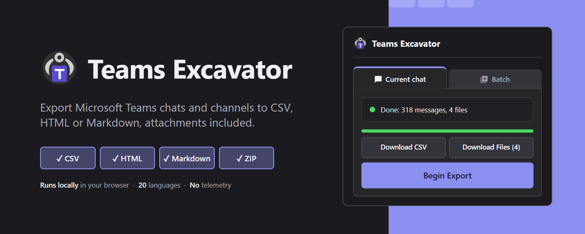
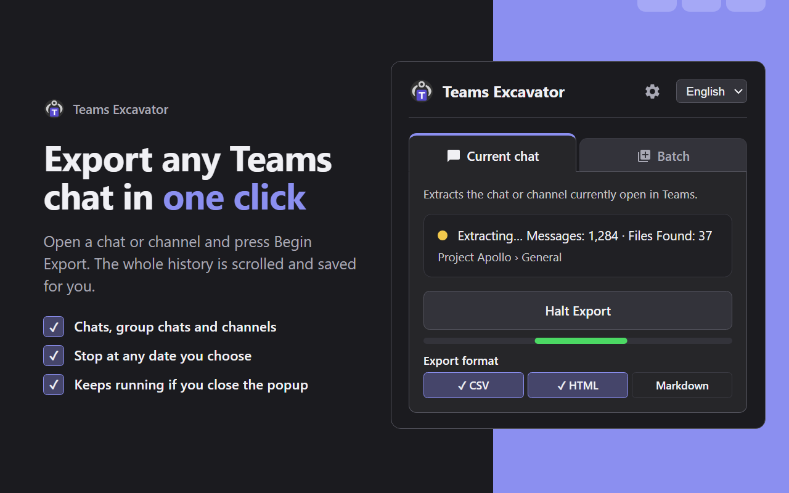
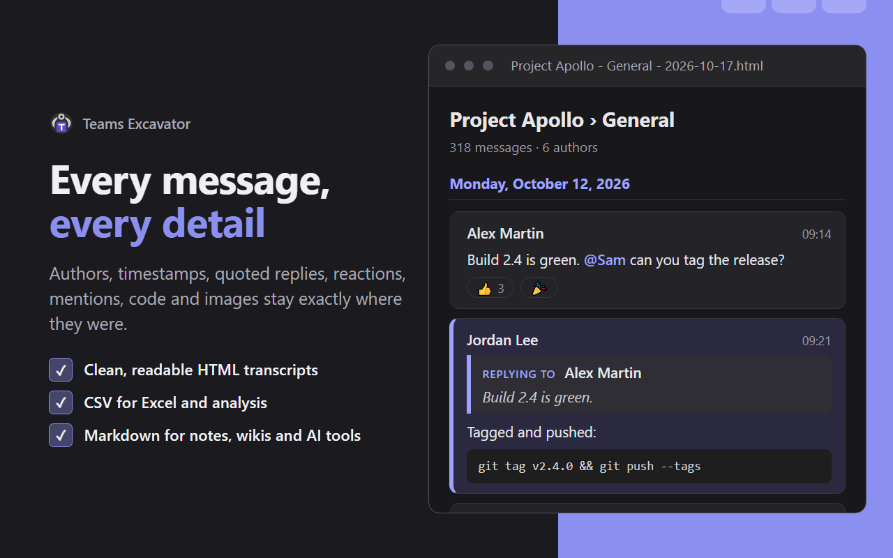
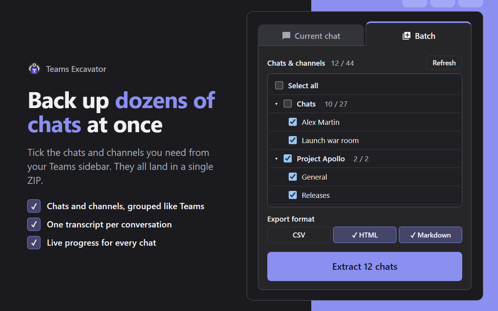
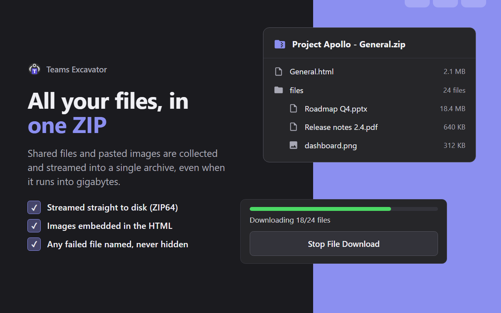

<p align="center">
  
</p>

<h1 align="center">Teams Excavator</h1>

<p align="center">
  <strong>Export any Microsoft Teams chat or channel in one click, files and images included.</strong><br>
  CSV · HTML · Markdown · ZIP, straight from Teams on the web.
</p>

<p align="center">
  
  
  
  
  <a href="LICENSE"></a>
</p>

---

## Why Teams Excavator?

Teams has no simple way to export a conversation. Copy-pasting loses authors, dates, replies and images, and admin exports are out of reach for most people. Teams Excavator scrolls the whole history for you and turns it into files you can read, search, archive or feed to other tools.

|  |  |
|---|---|
| ⚡ **One click** | Open a chat or channel, press **Begin Export**. The full history is scrolled and saved for you. |
| 🧵 **Every detail** | Authors, timestamps, quoted replies, reactions, mentions, code blocks and images stay where they were. |
| 📚 **Batch mode** | Tick dozens of chats and channels from your sidebar and get one transcript per conversation. |
| 📎 **All your files** | Shared files and pasted images are streamed into a single ZIP, even when it runs into gigabytes. |
| 🔒 **Private by design** | Everything runs in your browser. No server, no account, no tracking. |
| 🌍 **Your language** | 20 languages, right-to-left (Arabic, Urdu) included. |

## See it in action

<p align="center">
  
  
  
  
</p>

## Export formats

| Format | Best for |
|---|---|
| **HTML** | Clean, readable transcripts with images embedded, ready to archive or share |
| **CSV** | Excel, filtering and data analysis |
| **Markdown** | Notes, wikis and AI tools |
| **ZIP** | Every attachment of the conversation, streamed to disk (ZIP64, DEFLATE) |

## Features

- **Chats, group chats and channels**, including channel threads: replies are opened and captured
- **Stop at a date** to skip older messages
- **Live progress** with message and file counts, start/stop control and total extraction time
- **Keeps running** when you close the popup; downloads continue in the background
- **Readable file names** with the conversation and the date; unnamed group chats are titled with their participants
- **Failed files are named**, never silently skipped
- Works on `teams.microsoft.com`, `teams.live.com` and `teams.cloud.microsoft`, with your existing Teams sign-in

## Get started

1. Download or clone this repository.
2. Open `chrome://extensions` (or `edge://extensions`) and enable **Developer mode**.
3. Click **Load unpacked** and select the project folder.
4. Open [Teams on the web](https://teams.microsoft.com), open a chat or channel, click the extension icon and press **Begin Export**.
5. Choose **CSV**, **HTML**, **Markdown** or **Download files (zip)**.

> Keep the Teams tab open while extraction runs. Results live in that tab until you start a new extraction or reload it.

## Privacy

Your conversations never leave your computer. The extension has no server, no analytics and no external dependencies: exports are written straight to your Downloads folder. Read the full [privacy policy](PRIVACY.md).

| Permission | Why |
|---|---|
| `activeTab`, `scripting` | Inject the extraction script into the Teams tab |
| `storage` | Remember popup state and settings |
| `downloads` | Save exports and the ZIP |
| Host access to Teams, SharePoint, OneDrive | Fetch attachments referenced by messages |

## Limitations

- Extraction relies on the Teams web page, so a Microsoft update to Teams on the web can break it.
- Only what the web client can load is exported.
- Attachments must be accessible to your signed-in account.

## For developers

Plain vanilla JavaScript: no npm, no bundler, no TypeScript, no build step. See `AGENTS.md` for the architecture.

| Path | Role |
|---|---|
| `manifest.json` | MV3 manifest |
| `src/content/` | Extraction engine injected into Teams; holds the results |
| `service-worker.js`, `src/background/` | Exports (CSV/HTML/MD), streamed ZIP64 downloads |
| `src/popup/` | UI and language selection |
| `src/shared/` | Helpers shared by all contexts |
| `_locales/` | Translations |

To build the Chrome Web Store package:

```bash
./pack.sh
```

It writes `dist/teams-excavator-<version>.zip` from the committed state (HEAD), with only the files the extension loads: `manifest.json`, `service-worker.js`, `src/`, `_locales/`, `icons/`. It refuses to run while those files have uncommitted changes; `--force` packs HEAD anyway. On Windows, run it from Git Bash.

See the [changelog](CHANGELOG.md) for release history.

## Support

If Teams Excavator saved you an afternoon of copy-pasting, you can [🍺 buy me a beer](https://buymeacoffee.com/antoineferrieux).

## Disclaimer

This project is not affiliated with or endorsed by Microsoft. Only export data you are authorized to access, and respect your organization's policies.

Released under the [MIT License](LICENSE).
